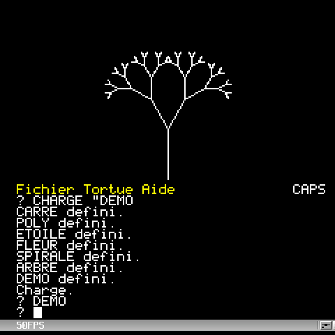
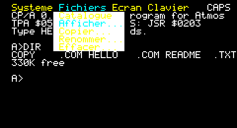

# CP/A — Control Program for Atmos

[English version](README.md)

*My Oric back to life: create, develop and publish — all on the lovely little machine itself.*

 ">

- **Votre Oric devient un vrai poste de travail** : menus déroulants, historique, complétion,
  éditeur et gestionnaire de fichiers plein écran.
- **Écrivez un jeu, dessinez-le, compilez-le** en 6502 rapide, sans jamais quitter la machine.
- **Puis partagez-le** : par la clé USB du LOCI aujourd'hui, sur une simple cassette pour tout
  Oric bientôt.
- **Solide comme un roc** : sur un vrai Atmos avec un LOCI, des séances de travail entières
  sans un plantage ni un redémarrage.

**L'essayer en cinq minutes.** Téléchargez [`cpa.dsk`](https://github.com/drpsy77/cpa-oric/raw/main/build/cpa.dsk), copiez-le sur la clé USB du LOCI
(ou la carte SD du Cumulus) et démarrez, ou lancez-le dans Oricutron (voir plus bas). Au
prompt `A>` :

    DIR               ce qu'il y a sur la disquette
    HELP              les rubriques d'aide
    LOGO DEMO         puis tapez DEMO : la tortue dessine un arbre
    GRAPHER CARTE     une île de tuiles tirée au hasard (flèches, Q pour finir)
    GRXASM SERPENT    traduit le jeu du serpent en assembleur...
    ASM SERPENT       ...l'assemble sur l'Oric...
    SERPENT           ...et lance la version compilée
    CMDER             gestionnaire de fichiers plein écran (ESC pour finir)

La touche FUNCT ouvre les menus partout.

**En vidéo** : GRAPHER et la route qui défile de `DEFILE.GRX`.

Mini système « à la CP/M » pour Oric Atmos, écrit en assembleur 6502. Version 0.9.

Deux variantes sont construites à partir des mêmes sources :

- **`build/cpa.dsk`**, la version principale : une disquette amorçable pour le contrôleur
  Microdisc, donc aussi pour le Cumulus et le LOCI. Le système se charge dans les 16 Ko de RAM
  overlay (`$C000-$FFFF`) cachés sous la ROM BASIC : aucune EPROM à graver, et l'espace des
  programmes reste intact. Quatre autres disquettes, par usage : `cpa-logo.dsk`,
  `cpa-notes.dsk`, `cpa-asm.dsk`, `cpa-anim.dsk` ; et une vierge, `cpa-projet.dsk`, pour son
  travail en `B:` à côté de la disquette système en `A:`. Chaque disquette existe en français
  et en anglais (`cpa-en.dsk`, `cpa-logo-en.dsk`... `cpa-project-en.dsk`) : mêmes programmes,
  mêmes exemples, avec les messages, les menus, l'aide et les exemples dans la langue de la
  disquette ; sur les anglaises, les exemples ont des noms anglais (`CARTE.GRX` y est
  `MAP.GRX` ; correspondance dans `files/en/noms.txt`). LOGO parle lui aussi la langue de la
  disquette (`AVANCE`, `POUR ... FIN` en français), et `LOGOTR` traduit un programme de
  l'une à l'autre.
- **`build/cpa.rom`**, une ROM de 16 Ko qui remplace la ROM BASIC : console et moniteur, sans
  disque.

## Ce qu'il y a dedans

- Un système compatible dans l'esprit avec CP/M 2.2 : prompt `A>`, fichiers CP/M sur quatre
  lecteurs, programmes `.COM` chargés en `$0500`, scripts `.BAT`, menus déroulants (FUNCT),
  édition de ligne avec historique et complétion par TAB ou ESC, mêmes touches dans tous les programmes (SHIFT et CTRL avec les flèches, CTRL-X/C/V), imprimante, graphisme et son.
- Des commandes de fichiers et de disquettes qui marchent avec un ou plusieurs lecteur(s) (COPY, FORMAT,
  DISKCOPY...), et **CMDER**, un gestionnaire de fichiers plein écran à deux colonnes.
- L'échange de fichiers avec la clé USB du LOCI (EXPORT, IMPORT, USBDIR, CMDER), et **TERM**, un terminal série pour un modem WiFi branché sur le LOCI (`docs/loci-modem-wifi.md`).
- Des outils pour développer sur l'Oric : **EDIT** (éditeur), **HEX** (éditeur hexadécimal),
  **ASM** (assembleur 6502), **DEBUG** (moniteur, désassembleur, pas à pas).
- **LOGO** en français et en anglais (tortue, décimaux, mots et listes, son ; `LOGOTR`
  traduit un programme de l'une à l'autre) et **GRAPHER**, un petit
  langage de dessin et de jeux (sprites en mode texte, cartes de tuiles plus grandes que
  l'écran, défilement compris), interprété ou traduit en
  assembleur.
- Images HIRES compressées et animations plein écran (VOIR).

## Stabilité

Sur un vrai Oric Atmos avec un LOCI, des séances entières passent sans un plantage ni un
redémarrage : importer des sources de la clé USB avec CMDER, les éditer, assembler un
programme sur l'Oric lui-même (`LOGOTR.COM`), ajouter un score à un jeu GRAPHER, jouer les
animations, ouvrir tous les menus de tous les programmes, et même débrancher la clé USB en
plein travail. Sur l'Oric, où redémarrer après un programme qui a piétiné la mémoire est un
rituel familier, c'est la première chose qu'on remarque. Cela tient à la conception :

- **un contrat mémoire** : le système vit dans la RAM overlay, hors de l'espace des
  programmes ; tout programme est chargé en `$0500` et parle au système par le BDOS et les
  variables documentées de la page 2 (`docs/architecture.md`) ;
- **un démarrage à chaud après chaque programme** : écran texte et console sont remis en
  place, même après une image HIRES plein écran ou un jeu en mode texte ;
- **la reprise** : la mémoire libre est laissée remplie de `$00` (`BRK`), un programme qui
  s'égare s'arrête donc sur `*BRK* at xxxx` ; le bouton RESET rend le prompt
  (`*RESET* at xxxx`) et, pendant un accès disque, attend la fin du secteur : le répertoire
  n'est jamais laissé à moitié écrit ;
- **des erreurs signalées, pas fatales** : un lecteur vide du LOCI, ou la clé USB
  débranchée, donne une erreur BDOS et le prompt ; la clé remise, `DIR` relit la disquette ;
- **des enregistrements sûrs** : EDIT et GRAPHER écrivent par `NOM.$$$`, un disque plein ou
  un RESET laisse l'ancien fichier ou le nouveau, entier (au pire sous `NOM.$$$`).

## Documentation

| Document | Contenu |
|---|---|
| `docs/manuel.md` | mode d'emploi : commandes, lecteurs, scripts, EDIT, HEX, ASM, DEBUG, images, son, programmation |
| `docs/logo.md` | LOGO |
| `docs/grapher.md` | GRAPHER |
| `docs/cmder.md` | CMDER |
| `docs/en/` | les quatre documents ci-dessus en anglais |
| `docs/vision.md` | but de CP/A, public, principes, ce qu'il n'est pas, la 1.0 |
| `docs/architecture.md` | couches, contrat d'interface (BIOS, BDOS, page 2), carte mémoire, conventions |
| `docs/systeme.md` | fonctionnement interne du système |
| `docs/memoire-pages-2-3.md` | variables des pages 2 et 3 |
| `docs/etat.md` | état du projet, suite prévue, réserves de place |
| `docs/projet-rom.md` | la version ROM |
| `docs/editeur-sprites.md` | éditeur de sprites et de caractères (spécification) |
| `docs/oric-basic.md` | CP/A pour l'Oric sous BASIC : sortie `.TAP`, routines pour le BASIC, jeux GRAPHER autonomes (spécification) |
| `docs/atelier.md` | construire et tester (outils, émulateurs, bancs d'essai) |
| `docs/essais-materiel.md` | essais sur le vrai Oric |
| `docs/points-de-fonction.md` | mesure : points de fonction IFPUG, algorithmes, lignes, octets, documentation |
| `docs/loci-modem-wifi.md` | relier un modem WiFi (Pico W) au LOCI : firmware, réglage, TERM |

## Construire

Il faut Python 3 et l'assembleur `xa` de l'OSDK. Le script `tools/build_xa.sh` le télécharge et
le compile dans `tools/xa` (macOS ou Linux, il faut git et un compilateur C++) :

    ./tools/build_xa.sh
    ./build.sh

`build.sh` prend `tools/xa` s'il existe ; sinon il utilise la variable `XA` ou le `xa` du PATH.

Sur Linux (Raspberry Pi compris), `tools/setup_linux.sh` installe en une fois tout l'atelier de
test : xa, py65 et un Oricutron piloté par script. Voir `docs/atelier.md`.

## Lancer dans Oricutron

Version disque : l'EPROM du Microdisc fait appel à la ROM BASIC 1.1, il faut donc garder
`atmosrom = 'roms/basic11b'` et avoir `roms/microdis.rom`.

    oricutron -m atmos -k microdisc -d build/cpa.dsk

Version ROM : copier `build/cpa.rom` dans `roms/`, puis mettre `atmosrom = 'roms/cpa'` dans `oricutron.cfg`.

Sur le matériel, copier `cpa.dsk` sur la clé USB (resp. la carte SD) du LOCI (resp. du Cumulus) et
démarrer dessus. CP/A est utilisé sur un vrai Oric Atmos avec un LOCI ; les couleurs des
menus, peu lisibles dans certains émulateurs, sont nettes sur un vrai écran.

**Plusieurs lecteurs.** La version disquette gère quatre lecteurs, `A:` à `D:`, comme le
contrôleur Microdisc, le LOCI et Oricutron (un `-d` par lecteur :
`oricutron -m atmos -k microdisc -d build/cpa.dsk -d donnees.dsk`) ; voir `docs/manuel.md`.

**Clock Signal** (macOS, Linux) démarre aussi `cpa.dsk`, et son minutage du lecteur est plus
proche du matériel qu'Oricutron. L'application ne met une disquette que dans `A:` ;
`tools/build_clk_mac.sh` construit sur un Mac (avec Xcode) une version à quatre lecteurs.

Sur l'Oric, `HELP` donne l'aide de chaque commande (`HELP` seul : la liste des rubriques).

## Licence

CP/A est distribué sous licence MIT (voir `LICENSE`). Les images `build/cpa.dsk` et
`build/cpa.rom` sont fournies prêtes à l'emploi ; `./build.sh` les reconstruit.
