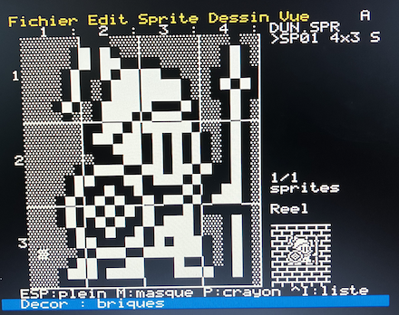

# CP/A — Control Program for Atmos

[Version française](README.fr.md)

*My Oric back to life: create, develop and publish — all on the lovely little machine itself.*

  prompt">

- **Your Oric becomes a real workstation**: pull-down menus, command history, completion, a
  full-screen editor and file manager.
- **Write a game, draw it, compile it** to fast 6502 code, without ever leaving the machine.
- **Then share it**: through the LOCI's USB stick today, on a plain cassette for any Oric soon.
- **Rock solid**: on a real Atmos with a LOCI, whole working sessions without a single
  crash or reboot.

**Try it in five minutes.** Download [`cpa-examples-en.dsk`](https://github.com/drpsy77/cpa-oric/raw/main/build/cpa-examples-en.dsk), put it on the USB stick of your LOCI
(or the SD card of your Cumulus) and boot, or run it in Oricutron (see below). At the `A>`
prompt:

    DIR               what's on the disk
    HELP              help topics
    GRAPHER MAP       explore a random island of tiles (arrows, Q to quit)
    GRXASM SNAKE      translate the snake game into assembly...
    ASM SNAKE         ...assemble it on the Oric...
    SNAKE             ...and play the compiled version
    CMDER             full-screen file manager (ESC to quit)

The FUNCT key opens the menus everywhere. Then [`cpa-anim-en.dsk`](https://github.com/drpsy77/cpa-oric/raw/main/build/cpa-anim-en.dsk):
`DEMO` (pictures and animations); [`cpa-logo-en.dsk`](https://github.com/drpsy77/cpa-oric/raw/main/build/cpa-logo-en.dsk): `LOGO DEMO`, then
`DEMO` (the turtle draws a tree).

**See it run**: GRAPHER and the scrolling road of `ROAD.GRX` (video, French version of the disk).

A small "CP/M-like" system for the Oric Atmos, written in 6502 assembly. Version 0.9.

Two variants are built from the same sources:

- **`build/cpa-en.dsk`**, the main version: a bootable disk for the Microdisc controller, and
  therefore also for the Cumulus and the LOCI. The system loads into the 16 KB of overlay RAM
  (`$C000-$FFFF`) hidden under the BASIC ROM: no EPROM to burn, and the program space stays
  intact. This is the system disk: every program (except LOGO) and all the help, no
  examples. Four more disks, by use, start on their own with their tools: `cpa-anim-en.dsk`
  (the demonstration), `cpa-logo-en.dsk` (LOGO), `cpa-examples-en.dsk` (GRAPHER and ASM
  examples), `cpa-notes-en.dsk` (writing); and a blank one, `cpa-project-en.dsk`, for your
  work in `B:` next to the system disk in `A:`. Every disk exists in English and in French (`cpa.dsk`, `cpa-logo.dsk`...):
  the same programs and the same examples, with the messages, menus, help and examples in the
  language of the disk; the examples have English names on the English disks (`MAP.GRX` is
  `CARTE.GRX` in French; the list is in `files/en/noms.txt`). LOGO speaks the language of the
  disk too (`FORWARD`, `TO ... END` in English), and `LOGOTR` translates a program from one
  to the other.
- **`build/cpa.rom`**, a 16 KB ROM that replaces the BASIC ROM: console and monitor, no disk.

## What's inside

- A system in the spirit of CP/M 2.2: `A>` prompt, CP/M files on four drives, `.COM`
  programs loaded at `$0500`, `.BAT` scripts, pull-down menus (FUNCT), line editing with
  history and TAB or ESC completion, the same keys in every program (SHIFT and CTRL with the
  arrows, CTRL-X/C/V), printer, graphics and sound.
- File and disk commands that work with one drive or several (COPY, FORMAT, DISKCOPY...),
  and **CMDER**, a full-screen two-panel file manager.
- File exchange with the LOCI's USB stick (EXPORT, IMPORT, USBDIR, CMDER), with CP/A's own current directory on the stick and all its devices (several sticks, the LOCI's internal memory), USBMOUNT to mount disk and tape images (and start BASIC on a tape), **TERM**, a serial terminal for a WiFi modem on the LOCI, and **XFER**, file transfer over that modem (XMODEM) with a small server for the Mac or a Raspberry Pi, `tools/xfer_server.py` (`docs/loci-modem-wifi.md`).
- Tools to develop on the Oric itself: **EDIT** (text editor), **HEX** (hex editor),
  **ASM** (6502 assembler), **DEBUG** (monitor, disassembler, single step), and **MKTAP**,
  which makes a `.TAP` tape that any Oric loads under BASIC with `CLOAD""` (machine code, data,
  or a BASIC program typed in EDIT and encoded exactly as the Oric's ROM would).
- **LOGO** in English and in French (turtle, decimals, words and lists, sound; `LOGOTR`
  translates a program from one to the other) and **GRAPHER**, a small
  language for drawings and games (text-mode sprites, tile maps larger than the
  screen, scrolling), interpreted or translated into assembly, with **EDSPRITE**, a
  full-screen editor for its sprites and characters. `GRXASM GAME /O` makes a translated
  game a `.TAP` that runs on any Oric without CP/A (`CLOAD""`): ready-made examples in
  `build/tap/`.
- Compressed HIRES pictures and full-screen animations (VOIR).

## Stability

On a real Oric Atmos with a LOCI, whole sessions go by without a single crash or reboot:
importing sources from the USB stick with CMDER, editing them, assembling a program on the
Oric itself (`LOGOTR.COM`), adding a score to a GRAPHER game, playing the animations, opening
every menu of every program, even pulling the USB stick out in the middle of the work. On
the Oric, where a reboot after a program has trampled the memory is a familiar ritual, this
is the first thing you notice. It comes from the design:

- **a memory contract**: the system lives in the overlay RAM, outside the program space;
  every program is loaded at `$0500` and talks to the system through the BDOS and the
  documented page 2 variables (`docs/architecture.md`);
- **a warm start after every program**: text screen and console are put back, even after a
  full-screen HIRES picture or a game in text mode;
- **recovery**: free memory is left filled with `$00` (`BRK`), so a program that runs astray
  stops on `*BRK* at xxxx`; the RESET button gives the prompt back (`*RESET* at xxxx`) and,
  during a disk access, waits for the end of the sector, so the directory is never left
  half-written;
- **errors are reported, not fatal**: an empty LOCI drive, or the USB stick pulled out, gives
  a BDOS error and the prompt; put the stick back and `DIR` reads the disk again;
- **safe saving**: EDIT and GRAPHER write through `NAME.$$$`, so a full disk or a RESET
  leaves the old file or the new one, whole (at worst under `NAME.$$$`).

## Documentation

The user documents are in English in `docs/en/`; the others are in French.

| Document | Contents |
|---|---|
| [`docs/en/manuel.md`](docs/en/manuel.md) | user manual: commands, drives, scripts, EDIT, HEX, ASM, DEBUG, pictures, sound, programming |
| [`docs/en/logo.md`](docs/en/logo.md) | LOGO |
| [`docs/en/grapher.md`](docs/en/grapher.md) | GRAPHER |
| [`docs/en/cmder.md`](docs/en/cmder.md) | CMDER |
| [`docs/en/edsprite.md`](docs/en/edsprite.md) | EDSPRITE, the sprite and character editor |
| `docs/vision.md` | what CP/A is for, who it is for, principles, what it is not, version 1.0 |
| `docs/architecture.md` | layers, interface contract (BIOS, BDOS, page 2), memory map, conventions |
| `docs/systeme.md` | how the system works inside |
| `docs/memoire-pages-2-3.md` | page 2 and page 3 variables |
| `docs/etat.md` | project status, what comes next, space reserves |
| `docs/projet-rom.md` | the ROM version |
| `docs/oric-basic.md` | CP/A for the Oric under BASIC: `.TAP` output (MKTAP), standalone GRAPHER games (`GRXASM /O`, `ORIC.INC`), routines for BASIC later (specification) |
| `docs/atelier.md` | building and testing (tools, emulators, test benches) |
| `docs/essais-materiel.md` | tests on a real Oric |
| `docs/points-de-fonction.md` | measurement: IFPUG function points, algorithms, lines, bytes, documentation |
| `docs/usb.md` | the LOCI's USB sticks from CP/A: current directory, mounting disks and tapes, duplicating, renaming, erasing (reference of level 1, in French) |
| `docs/loci-modem-wifi.md` | connecting a WiFi modem (Pico W) to the LOCI: firmware, set-up, TERM, XFER |

## Building

You need Python 3 and the OSDK `xa` assembler. `tools/build_xa.sh` downloads and compiles it
into `tools/xa` (macOS or Linux; needs git and a C++ compiler):

    ./tools/build_xa.sh
    ./build.sh

`build.sh` uses `tools/xa` if it exists; otherwise the `XA` variable or the `xa` on the PATH.

On Linux (Raspberry Pi included), `tools/setup_linux.sh` installs the whole test bench at
once: xa, py65 and a script-driven Oricutron. See `docs/atelier.md`.

## Running in Oricutron

Disk version: the Microdisc EPROM calls the BASIC 1.1 ROM, so keep
`atmosrom = 'roms/basic11b'` and have `roms/microdis.rom`.

    oricutron -m atmos -k microdisc -d build/cpa-en.dsk

ROM version: copy `build/cpa.rom` into `roms/`, then set `atmosrom = 'roms/cpa'` in
`oricutron.cfg`.

On real hardware, copy `cpa-en.dsk` to the USB stick of the LOCI (or the SD card of the Cumulus)
and boot from it. CP/A is used on a real Oric Atmos with a LOCI; the menu colours, hard to read
in some emulators, are sharp on a real screen.

**Several drives.** The disk version handles four drives, `A:` to `D:`, like the Microdisc
controller, the LOCI and Oricutron (one `-d` per drive:
`oricutron -m atmos -k microdisc -d build/cpa-en.dsk -d data.dsk`); see `docs/en/manuel.md`.

**Clock Signal** (macOS, Linux) also boots `cpa-en.dsk`, and its drive timing is closer to the
hardware than Oricutron's. The application only puts a disk in `A:`;
`tools/build_clk_mac.sh` builds a four-drive version on a Mac (with Xcode).

On the Oric, `HELP` gives help on each command (`HELP` alone: the list of topics).

## Licence

CP/A is distributed under the MIT licence (see `LICENSE`). The disk images (`build/*.dsk`) and
`build/cpa.rom` are ready to use; `./build.sh` rebuilds them.
